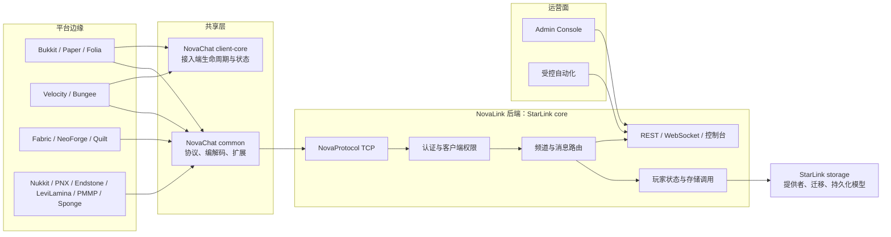

# 架构参考

NovaLink 的架构目标是把多种 Minecraft 平台的差异留在边缘，把认证、频道、消息路由、持久化和运营控制集中在后端。仓库通过共享协议层连接后端与接入端，同时保持生产后端与插件运行时之间的依赖隔离。[1] [2]

> **核心边界。** `NovaChat/common` 负责协议与通用能力；`NovaChat/client-core` 只服务于插件/模组接入端运行时；`StarLink/core` 是独立的生产后端。后端依赖共享协议层和独立存储层，不能反向依赖客户端运行时。[2]

## 1. 组件全景



此图表示责任边界，不表示所有平台模块采用完全相同的内部代码。接入端在平台 API、生命周期和线程模型上保留本地实现；共享层提供协议与可复用运行时能力，避免把 Minecraft 平台 API 带入后端核心。[1] [2]

## 2. Gradle 模块地图

`settings.gradle` 当前声明了共享层、后端、Bukkit/代理、Bedrock、Sponge 和多 Loader 模组子项目。非 Java 的 Bedrock 模块通过各自原生工具链接入，不应被当作与 Java 模块相同的 Gradle Java 子项目。[1] [3]

| 领域 | 位置 | 主要责任 |
| --- | --- | --- |
| 共享协议 | `NovaChat/common` | NovaProtocol 数据包、编解码、心跳限速与请求 ID 记忆、提及/物品展示辅助、扩展、事件与命令注册。 |
| 客户端运行时 | `NovaChat/client-core` | 接入端连接生命周期、重连策略、请求跟踪、频道/聊天状态和格式工具。 |
| 存储共享层 | `StarLink/storage` | 数据提供者、迁移、持久化模型和玩家状态缓存；供后端和代理 lite 模式使用。 |
| 中心后端 | `StarLink/core` | Netty 服务端、认证、频道、路由、治理流程、管理 API、WebSocket 与控制台。 |
| 嵌入式后端宿主 | `StarLink/plugin/bukkit` | Bukkit 启停适配和控制台桥接；Gradle 项目名为 `:StarLink:plugin:novalink-bukkit`。 |
| 代理共享层 | `NovaChat/Proxy/common` | 代理聊天、命令、切服、lite 本地权威和 relay 后端连接选择；项目名为 `:NovaChat:Proxy:proxy-common`。 |
| 代理消息协议 | `NovaChat/Proxy/channel` | 子服与代理的 `novachat:main` 消息编解码；Bukkit 和代理两侧复用。 |
| Java 平台接入 | `NovaChat/Plugin`、`Proxy`、`Sponge`、部分 `Bedrock` | 调用各自平台 API、承载本地命令/UI 与连接后端。 |
| 模组接入 | `NovaChat/MOD` | Fabric、NeoForge、Quilt 的共享/Loader 适配。 |
| 非 Java Bedrock 接入 | `NovaChat/Bedrock/endstone`、`levilamina`、`pmmp` | 由原生、PHP 或 Python 生态的工具链负责构建和运行。 |
| 管理面板 | `Panel/web` | React + Vite 前端，使用后端 REST 与 WebSocket。 |
| 真实 E2E | `test/` | 平台真实服务端、机器人与后端的可选验证编排。 |

## 3. 依赖方向

```text
StarLink/plugin/bukkit ──► StarLink/core ──► NovaChat/common
                                └────────► StarLink/storage

Java 平台插件 / 模组 ────► NovaChat/client-core ──► NovaChat/common
Velocity / Bungee ──────► NovaChat/Proxy/common
                                ├────────► NovaChat/client-core
                                ├────────► NovaChat/Proxy/channel ──► NovaChat/common
                                └────────► StarLink/storage
Bukkit 子服 ────────────► NovaChat/Proxy/channel
```

箭头表示模块依赖。`client-core` 提供接入端连接与状态工具，后端传输实现仍留在 `StarLink/core`。双方共用的数据包和编解码放在 `common`；Java 平台 API 留在各适配模块。[1] [2]

`common/protocol/keepalive` 统一维护心跳发送预算与有界请求 ID 记忆。后端和客户端原有网络包下的公开类保留为委托入口，`ClientConnection.getKeepAliveBudget()` 的返回类型不变；请求 ID 按 UUID 值匹配，客户端重连仍清空旧连接记录。两端的网络处理和生命周期继续由各自模块负责。[14] [15]

`StarLink/storage` 不依赖 `common`、Netty、JWT 或认证管理器。它承载 JDBC、Redis、内存实现和持久化模型；治理权限、消息分发和审核状态机仍由后端业务管理器负责。存储层与核心保留部分相同包名，包级可见性按 Java 包生效。[8]

三种 JDBC 提供者共用 `JdbcStringCollections` 保存玩家已加入频道和频道允许世界。schema v17 为两列分别增加格式字段：`0` 按旧逗号规则读取，`1` 保存及读取 JSON 字符串数组。新保存同时更新内容和格式；旧行不批量改写，原值即使看起来像 JSON，也按旧格式解释。未知格式或损坏的新数据返回存储错误，避免把世界限制误读为空列表。[28]

这一编码保留逗号、引号、反斜杠及空字符串。旧逗号数据已丢失的元素边界无法自动恢复，需按原配置修正并重新保存。v17 在已有迁移之后追加格式列，不修改旧迁移 SQL；核心与代理 lite 随存储模块使用相同版本。Redis 和内存提供者保留各自已有的集合表示。[28]

Redis 通知、审计和消息历史共用有序索引遍历，每批最多读取 128 个 ID，筛选后再计算页内偏移，收齐当前页即停止。需要逐条筛选的总数查询也分批读取；稀疏筛选和精确计数的时间成本仍随候选数量增长。遍历使用 `ZREVRANGEBYSCORE`（含分数）、`ZREVRANK` 和 `ZCOUNT`，Redis 命令白名单应允许这些读取。[19]

代理 lite 模式通过 `LocalAuthority` 维护本地频道与治理状态，`LiteChannelStore` 经存储模块保存数据；relay 模式由 `BackendRouter` 按玩家所在子服选择后端连接和客户端身份。两种模式共享代理平台接口，不把完整后端装入代理进程。[9] [10]

## 4. 后端启动与运行时装配

`NovaLinkMain` 负责命令行参数、交互控制台或 daemon 等待，以及 JVM 关闭钩子。`NovaLinkCore` 负责可嵌入的启动与停止：读取配置、初始化认证和存储、装配频道与路由、注册治理处理器，然后启动 TCP 与管理网关。Bukkit 宿主也调用同一个核心，核心不注册 JVM 钩子，也不退出宿主进程。[4] [11] [12]

核心只在初始化完成后发布 `BackendContext`；启动失败时回收已登记资源。正常停止依次关闭入口、等待 REST 工作线程、停止业务管理器、刷新玩家状态，最后关闭数据库。配置监听器和消息日志服务同属核心生命周期。[11]

`PlayerStateFlushService` 每隔 30 秒刷新一次玩家脏状态，间隔从上一轮结束后计算，单个任务串行运行。它调用共享 `PlayerStateManager.saveAllDirty()`，同时保存在线修改和重试离线写入；单轮异常不会取消后续调度。调度属于核心，存储模块仍仅提供状态与持久化操作，代理 lite 保留原逐次保存方式。[11] [27]

刷新服务在启动时登记回收，失败回滚也会停止任务。正常关闭先停止周期刷新，再执行最后一次玩家保存，最后关闭数据库。服务停止复用 `ShutdownBudget`，等待最多 5 秒且受剩余预算限制；超时中断正在执行的任务，并取消后续轮次。[13] [27]

TCP 频道 CREATE、DELETE 使用 `ChannelManager` 的存储提交边界。未绑定提供者的兼容装配可按次传入数据库，不改变管理器之后的存储配置；已绑定提供者优先。创建保存失败撤回登记与索引，删除失败保留登记、成员、权限、邀请和玩家状态。协议返回 `NC-510`，不再由网络层吞掉失败后报告成功。[22] [24]

频道启动加载完成后，核心把数据库提供者绑定到 `ChannelManager`，后续动态频道创建、更新、删除统一持久化。CONFIG 频道由 YAML 管理，管理器不把它们写成动态记录，也不删除被配置覆盖的同名存储记录。加载阶段不反写配置与原存储记录；TCP 在管理器已接入持久化时省去重复写入，独立内存模式仍保留原来的保存入口。[11]

核心向 `ChannelManager` 装配同步删除清理：存储删除成功后，在释放频道 ID 前清除缓存玩家的频道记录、频道管理员、监控会话和私有 ID 跟踪。REST、控制台、TCP 和重载删除都经过这一边界。独立调用未装配核心清理时，由入口提供本地清理；成员清理复用 `ChannelStateCleanup`。[11] [16]

邀请创建、接受和频道删除共用频道锁。删除先清除旧邀请，再释放频道 ID；同名新频道需创建新邀请。动态频道与邀请由同一提供者提交删除；JDBC 三种实现共用单连接事务。CONFIG 频道只清理邀请，保留被配置覆盖的同名动态记录。独立内存频道登记表也通过邀请管理器绑定的存储完成邀请清理。[17] [18]

`ShutdownBudget` 在同一次停止或启动回滚中共享等待截止时间。预算用尽后，剩余组件仍收到停止请求；线程池转为取消排队任务和中断工作，不再清空未执行的清理队列。各管理器原有无参数停止入口保留。[13]

| 子系统 | 主要责任 | 关键边界 |
| --- | --- | --- |
| `AuthManager` / `IpBanManager` | 客户端与管理身份认证、认证失败保护 | 客户端身份不能替代控制面管理员身份。 |
| `ClientPermissionRegistry` | 客户端级全局频道权限 | 未显式配置时存在向后兼容的授权行为，生产应审阅。 |
| `ChannelManager` | 频道定义与成员关系 | 频道写入与入群共用频道锁；重载清理按对象身份删除，保留同名新频道。 |
| `MessageRouter` / `MessagePipeline` | 路由与消息处理协作 | 频道、禁言/封禁、过滤、日志、跨服开关与 WebSocket 广播在此交汇。 |
| `DatabaseProvider` | 状态与运营数据提供者 | 由配置选择，不同提供者有不同持久化语义。 |
| `WebSocketGateway` | HTTP 认证、REST、WebSocket 会话与周期推送 | 是管理控制面网关，而非独立聊天后端。 |
| `BackendConsole` | 本地交互式管理 | 支持观察、治理、频道、公告、重载和停止操作。 |

## 5. 消息与控制面

NovaLink 的**数据面**是平台接入端通过 NovaProtocol 发送并接收的频道消息与相关动作；**控制面**是管理员通过控制台、REST、WebSocket 和 Admin Console 观察或修改系统状态。管理网关通过 `WebSocketGateway` 组合 HTTP 认证处理器、REST 处理器和 WebSocket 消息处理器，并把路由后的聊天消息转发给已经订阅相应频道的已认证会话。[4] [5]

| 流程 | 起点 | 核心处理 | 终点 |
| --- | --- | --- | --- |
| 平台接入 | NovaChat 接入端 | TCP 建连、握手、认证、权限引导 | 已认证客户端会话。 |
| 聊天路由 | 频道中的玩家消息 | 频道边界、治理状态、过滤、日志、扇出 | 目标平台接入端与对应 WS 订阅者。 |
| 配置变化 | 文件监听、控制台或 REST 重载 | 配置解析、运行时应用、配置同步 | 已连接客户端与运维日志。 |
| 管理操作 | Panel、自动化或本地控制台 | JWT/会话校验、REST/WS/控制台处理器 | 频道、玩家、客户端、通知或进程状态。 |

### 状态写入与并发边界

| 状态 | 写入所有者 | 并发规则 |
| --- | --- | --- |
| 配置与 revision | `ConfigManager` | 在同一提交锁内校验版本、保存候选配置，再发布运行时和广播。 |
| 玩家连接归属 | `ServerNetworkHandler` + `ChannelActionHandler` | 当前代际断开时按客户端移除在线玩家和成员；旧代际断开不清理新连接。玩家迁移、普通退群和退出清理共用逐玩家边界，并在清理前重查归属。 |
| 玩家状态保存 | `PlayerStateManager` | 同一 UUID 的保存、加载、单人移除及删除串行执行；成功只清除原脏版本，退出后的失败写入单独保留待重试。 |
| 频道入群、邀请与删除 | `ChannelManager` + `ChannelActionHandler` + 邀请/私有频道管理器 | JOIN、CREATE、ACCEPT 的成员及玩家状态提交受频道锁约束；旧创建对象不得向同名新频道补写状态。删除先清理邀请再释放 ID。 |
| 禁言与封禁 | `AbstractModerationManager` + `BanManager` | 同一玩家的应用和解除先提交存储，再发布缓存；失败保留旧限制，封禁成功后移除成员并清理在线玩家的已加入频道及当前频道。 |
| 协议入群与封禁 | `BanManager` + `ChannelActionHandler` | JOIN、ACCEPT、CREATE 共用同一玩家的封禁写入边界，覆盖权限检查、邀请扣额、成员加入和玩家状态更新。 |
| 案件与申诉 | `ModerationManager` + `DatabaseProvider` | 业务层校验身份与状态；存储层条件更新，申诉与案件在一次原子操作中提交。 |
| 批量治理幂等 | `RestApiHandler` | 操作人与有效请求绑定 key；执行前登记，完成后发布原响应，进行中的记录不被淘汰。 |
| 活动状态与任务 | `CampaignManager` | 每个活动串行转换；发送成功才进入 `ACTIVE`，恢复时先检查结束时间。 |
| 面板登录与 token | `AuthService` | 登录会话与 token 轮换分开计数；旧会话请求不能以新身份刷新或重试。 |
| 面板频道与玩家列表 | `useEntitySnapshot` | WebSocket 更新和较新读取使旧 REST 结果失效。 |
| 面板设置 | `settingsStore` / `useSettings` | 使用服务器 revision 协调 REST 保存和 WebSocket 快照。 |

面板玩家的 `muted` 从 `MuteManager` 当前限制派生，不再把 `PlayerState.mutes` 当作第二份运行时权威。REST 列表、详情及 WebSocket 请求、广播共用 `PanelResourcePolicy.hasVisibleMute`，只反映当前角色可见且未到期的禁言。网关向两种传输注入同一个管理器；旧 WebSocket 构造入口保留按玩家快照读取的方式，并执行相同过滤。[20] [25]

`PlayerStateManager` 每次标脏都替换版本标记，保存时向提供者传入副本。保存成功后按原标记条件清除，失败保留待保存状态。保存、加载和移除复用缓存的逐 UUID 原子更新边界，避免较旧快照最后覆盖数据库。核心与代理 lite 模式共用这一实现。[26]

退出保存失败时，状态转入内存待重试区，在线名单和私信查找仍视玩家为离线。`saveAllDirty()` 同时刷新在线脏状态和离线待重试状态，离线刷新不会重建在线缓存；重新登录优先恢复待重试状态。显式 `loadState()` 在读取数据库前先提交待重试的离线写入，提交失败时返回空值，保留最新状态。[26]

当前客户端代际断开时，核心调用 `ChannelActionHandler.disconnectClient()`，清除该客户端玩家的频道成员、已加入频道及当前频道，并推送一次玩家列表更新。成员清理与显式退出共用同一实现；原私信偏好等玩家字段保留。同名新连接已经接管时，旧物理连接的断开跳过客户端清理。[11] [22]

批量清理在逐玩家入群与封禁边界内重查实例和 `clientId`，跳过已迁往另一客户端的玩家。`PlayerStateManager.detachState()` 仅移走仍是当前缓存实例的状态，并登记待保存，不在断开回调中逐个保存玩家。后台刷新或最终停机刷新负责落库，失败保持待重试；重新登录仍可取回未保存状态。[21] [22] [26] [27]

`clearCache(true)` 移除在线记录并保留失败写入；`clearCache(false)` 显式丢弃缓存和待重试记录。`deleteState()` 删除成功后清除两者，防止后续刷新重建已删除数据。直接 `saveState()` 成功仍会缓存传入状态；待重试区仅保留在当前进程内。[26]

`getOrCreateState()` 只有在数据库成功返回无记录时才创建默认状态。读取异常抛出 `StateLoadException`，保留原数据库记录，缓存和待保存区均不新增默认对象。`prepareState()` 读取候选状态而不发布在线记录，`cachePreparedState()` 在提交时采用当前缓存或待重试实例，避免旧候选覆盖较新状态。[26]

协议 JOIN、CREATE、ACCEPT 在加入成员、保存频道定义或扣除邀请码次数前准备玩家状态，提交时共用上述发布入口。普通 LEAVE 也在移除成员前完成加载。读取失败返回 `NC-510`，客户端可稍后重试；状态提交继续受原频道对象身份与频道锁约束。[22] [26]

普通 LEAVE 与显式退出共用归属检查，在逐玩家边界内读取当前在线记录。记录属于其他客户端时返回 `NC-403`，不修改成员、玩家状态或发送离开通知。成功 JOIN 仍可迁移玩家归属；受邀的跨客户端私有频道成员仍可正常退群。没有在线记录时，普通 LEAVE 保留先加载再清理的原入口。[21] [22] [26]

这些边界决定共享代码的位置。持久化事务放在提供者内；平台调度放在平台桥接内；前端快照采用规则放在实体状态入口。HTTP 处理器和组件调用这些入口，避免各自复制状态机。具体错误码和恢复操作见 [Admin REST API](admin-api.md)。

`BanManager.withAdmission` 复用封禁缓存的逐玩家原子更新边界，不另建玩家锁表。封禁先提交时，后续入群拒绝；入群先执行时，后续封禁移除其成员资格。全局封禁还阻止通过 CREATE 自动加入新私有频道。回调内不能再修改封禁，避免重入同一缓存更新；频道容量与邀请扣额继续由频道锁协调。[21]

JOIN 的访问检查与成员、玩家状态写入绑定同一个频道对象。删除或配置替换先完成时，旧对象返回 `NC-404`；JOIN 先完成时，删除清理随后执行。私有管理器的直接入群入口也在频道锁内重查身份，避免向已删除对象追加成员。跨客户端的既有私有成员恢复仍可用；新成员继续校验客户端与密码。[22] [23]

CREATE 准备玩家状态后，由频道管理器保存定义，再在登记创建者和生成 ID 时检查频道对象仍有效；协议层于频道锁内复核身份，提交权限及玩家状态。ACCEPT 通过邀请管理器的成功回调在释放频道锁前发布已准备的玩家状态，回调不依赖协议类型，原三参数接口保留。删除先完成时，旧创建结果返回 `NC-404`；提交先完成时，后续删除清理全部关联状态。[12] [17] [22] [23]

核心将 `PlayerStateManager` 注入 `BanManager`，使 REST、TCP 和控制台封禁共享在线状态清理。频道封禁保留其他频道；全局封禁还清理已删除频道及仅存在于 `activeChannel` 的引用。状态通过 `leaveChannel` 标记待保存，存储失败不触发清理。原三参数构造保留只维护频道成员的独立使用方式。[11] [21]

## 6. 频道作用域与隔离

后端的频道模型至少区分全局、服务端和私有边界。全局频道从 `global_channels` 创建，客户端频道绑定 `clientId`；当客户端配置把自己的频道写为 `GLOBAL` 时，后端会强制改为 `SERVER` 以保持跨客户端隔离。运行时私有频道不会被配置重载覆盖。[11]

控制面通过 `PanelResourcePolicy` 共享频道资源授权。VIEWER 可见 `GLOBAL`，ADMIN 可见并管理 `GLOBAL` 与 `SERVER`，`PRIVATE` 仅向 SUPER_ADMIN 开放。频道级禁言、封禁、解除限制及踢出复用这一策略，限制列表在投影与计数前过滤；批量预览、执行和缓存重放在副作用或缓存读取前检查当前角色。没有频道 ID 的全局限制继续由 ADMIN 及以上管理；已删除频道的遗留限制仅向 SUPER_ADMIN 展示并提供单人解除入口。[20]

这种模型意味着“名字相同”不等于“路由范围相同”。设计频道时应首先决定数据面边界、权限节点和世界条件，再决定客户端展示名称、格式或面板标签。

重载中，CONFIG 频道的作用域或客户端绑定变化会替换原对象，清理旧成员和关联运行时状态，再建立新索引；普通属性修改保留对象与成员。动态频道继续跳过。频道 ID 在当前登记表中唯一，配置重复声明按启动时的顺序保留第一个定义，并记录警告。[11]

## 7. 管理面板的角色

`Panel/web` 不是第二套业务后端。它会经 REST 获取频道、玩家、设置和运营数据，并经 WebSocket 接收状态、频道、玩家、通知和已订阅聊天事件。前端默认通过同源 `/api` 请求 REST，并连接当前主机 `8889` 端口的 WebSocket，生产环境一般由反向代理提供稳定的外部入口。[6] [7]

状态由 `useDashboardData` 和 `useWsOrchestration` 协作提供，传输集中在 `services/api.js`、`auth.js` 和 `websocket.js`。`connectionUrls.js` 统一解析连接地址，页面组件不直接建立网络连接。[6] [7]

## 8. 架构变更审阅问题

当变更影响任意一个模块时，请先回答以下问题：

| 问题 | 为什么重要 |
| --- | --- |
| 这是协议、接入端运行时还是后端业务能力？ | 决定代码应落在协议、接入运行时、存储还是后端业务模块。 |
| 是否引入了后端到平台 API 的依赖？ | 会破坏生产后端的平台无关性。 |
| 是否改变认证、客户端权限或频道作用域？ | 可能扩大消息可见范围或控制面权限。 |
| 是否需要更新 REST/WS、配置或面板？ | 避免后端实现与控制面契约脱节。 |
| 是否需要增加真实环境验证？ | 多平台差异无法仅靠编译发现。 |

## 参考资料

[1]: ../../settings.gradle "NovaLink Gradle 子项目结构"
[2]: ../../NovaChat/client-core/DESIGN.md "三层架构与依赖方向"
[3]: ../../build.gradle "非 Java Bedrock 模块构建边界"
[4]: ../../StarLink/core/src/main/java/com/nova/link/NovaLinkMain.java "独立进程启动入口"
[5]: ../../StarLink/core/src/main/java/com/nova/link/websocket/WebSocketGateway.java "控制面网关与路由广播"
[6]: ../../Panel/web/src/hooks/useDashboardData.js "面板实体状态与 REST 调用"
[7]: ../../Panel/web/src/hooks/useWsOrchestration.js "面板连接与实时状态消费"
[8]: ../../StarLink/storage/build.gradle "存储模块依赖与打包边界"
[9]: ../../NovaChat/Proxy/common/build.gradle "代理共享模块依赖"
[10]: ../../NovaChat/Proxy/common/src/main/java/com/nova/chat/proxy/relay/BackendRouter.java "relay 连接与身份选择"
[11]: ../../StarLink/core/src/main/java/com/nova/link/NovaLinkCore.java "核心装配与生命周期"
[12]: ../../StarLink/plugin/bukkit/src/main/java/com/nova/link/bukkit/NovaLinkBukkitPlugin.java "Bukkit 后端宿主"
[13]: ../../StarLink/core/src/main/java/com/nova/link/lifecycle/ShutdownBudget.java "共享停止预算与强制取消"
[14]: ../../NovaChat/common/src/main/java/com/nova/chat/common/protocol/keepalive/KeepAliveBudget.java "共享心跳发送预算"
[15]: ../../NovaChat/common/src/main/java/com/nova/chat/common/protocol/keepalive/RecentKeepAlives.java "共享请求 ID 记忆"
[16]: ../../StarLink/core/src/main/java/com/nova/link/channel/ChannelStateCleanup.java "共享频道成员与缓存玩家状态清理"
[17]: ../../StarLink/core/src/main/java/com/nova/link/channel/InvitationManager.java "邀请创建、接受与频道生命周期"
[18]: ../../StarLink/storage/src/main/java/com/nova/link/database/AbstractJdbcProvider.java "频道与邀请共享事务删除"
[19]: ../../StarLink/storage/src/main/java/com/nova/link/database/RedisProvider.java "Redis 有序索引分批读取与筛选"
[20]: ../../StarLink/core/src/main/java/com/nova/link/auth/PanelResourcePolicy.java "控制面共享资源授权"
[21]: ../../StarLink/core/src/main/java/com/nova/link/ban/BanManager.java "封禁与入群共享串行边界"
[22]: ../../StarLink/core/src/main/java/com/nova/link/network/ChannelActionHandler.java "协议 JOIN 的频道身份与状态提交"
[23]: ../../StarLink/core/src/main/java/com/nova/link/channel/PrivateChannelManager.java "私有频道访问与成员加入"
[24]: ../../StarLink/core/src/main/java/com/nova/link/channel/ChannelManager.java "频道存储提交、回滚及按次持久化"
[25]: ../../StarLink/core/src/main/java/com/nova/link/websocket/WebSocketGateway.java "REST 与 WebSocket 的共享管理器装配"
[26]: ../../StarLink/storage/src/main/java/com/nova/link/database/PlayerStateManager.java "玩家状态保存顺序与脏版本"
[27]: ../../StarLink/core/src/main/java/com/nova/link/database/PlayerStateFlushService.java "运行中玩家状态刷新与离线重试调度"
[28]: ../../StarLink/storage/src/main/java/com/nova/link/database/JdbcStringCollections.java "JDBC 集合编码与旧格式读取"
