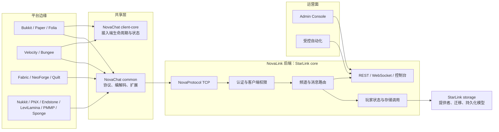

# 架构参考

NovaLink 的架构目标是把多种 Minecraft 平台的差异留在边缘，把认证、频道、消息路由、持久化和运营控制集中在后端。仓库通过共享协议层连接后端与接入端，同时保持生产后端与插件运行时之间的依赖隔离。[1] [2]

> **核心边界。** `NovaChat/common` 负责协议与通用能力；`NovaChat/client-core` 只服务于插件/模组接入端运行时；`StarLink/core` 是独立的生产后端。后端依赖共享协议层和独立存储层，不能反向依赖客户端运行时。[2]

## 1. 组件全景



此图表示责任边界，不表示所有平台模块采用完全相同的内部代码。接入端在平台 API、生命周期和线程模型上保留本地实现；共享层提供协议与可复用运行时能力，避免把 Minecraft 平台 API 带入后端核心。[1] [2]

## 2. Gradle 模块地图

`settings.gradle` 当前声明了共享层、后端、Bukkit/代理、Bedrock、Sponge 和多 Loader 模组子项目。非 Java 的 Bedrock 模块通过各自原生工具链接入，不应被当作与 Java 模块相同的 Gradle Java 子项目。[1] [3]

| 领域 | 位置 | 主要责任 |
| --- | --- | --- |
| 共享协议 | `NovaChat/common` | NovaProtocol 数据包、编解码、提及/物品展示辅助、扩展、事件与命令注册。 |
| 客户端运行时 | `NovaChat/client-core` | 接入端连接生命周期、重连策略、请求跟踪、频道/聊天状态和格式工具。 |
| 存储共享层 | `StarLink/storage` | 数据提供者、迁移、持久化模型和玩家状态缓存；供后端和代理 lite 模式使用。 |
| 中心后端 | `StarLink/core` | Netty 服务端、认证、频道、路由、治理流程、管理 API、WebSocket 与控制台。 |
| 嵌入式后端宿主 | `StarLink/plugin/bukkit` | Bukkit 启停适配和控制台桥接；Gradle 项目名为 `:StarLink:plugin:novalink-bukkit`。 |
| 代理共享层 | `NovaChat/Proxy/common` | 代理聊天、命令、切服、lite 本地权威和 relay 后端连接选择；项目名为 `:NovaChat:Proxy:proxy-common`。 |
| 代理消息协议 | `NovaChat/Proxy/channel` | 子服与代理的 `novachat:main` 消息编解码；Bukkit 和代理两侧复用。 |
| Java 平台接入 | `NovaChat/Plugin`、`Proxy`、`Sponge`、部分 `Bedrock` | 调用各自平台 API、承载本地命令/UI 与连接后端。 |
| 模组接入 | `NovaChat/MOD` | Fabric、NeoForge、Quilt 的共享/Loader 适配。 |
| 非 Java Bedrock 接入 | `NovaChat/Bedrock/endstone`、`levilamina`、`pmmp` | 由原生、PHP 或 Python 生态的工具链负责构建和运行。 |
| 管理面板 | `Panel/web` | React + Vite 前端，使用后端 REST 与 WebSocket。 |
| 真实 E2E | `test/` | 平台真实服务端、机器人与后端的可选验证编排。 |

## 3. 依赖方向

```text
StarLink/plugin/bukkit ──► StarLink/core ──► NovaChat/common
                                └────────► StarLink/storage

Java 平台插件 / 模组 ────► NovaChat/client-core ──► NovaChat/common
Velocity / Bungee ──────► NovaChat/Proxy/common
                                ├────────► NovaChat/client-core
                                ├────────► NovaChat/Proxy/channel ──► NovaChat/common
                                └────────► StarLink/storage
Bukkit 子服 ────────────► NovaChat/Proxy/channel
```

箭头表示模块依赖。`client-core` 提供接入端连接与状态工具，后端传输实现仍留在 `StarLink/core`。双方共用的数据包和编解码放在 `common`；Java 平台 API 留在各适配模块。[1] [2]

`StarLink/storage` 不依赖 `common`、Netty、JWT 或认证管理器。它承载 JDBC、Redis、内存实现和持久化模型；治理权限、消息分发和审核状态机仍由后端业务管理器负责。存储层与核心保留部分相同包名，包级可见性按 Java 包生效。[8]

代理 lite 模式通过 `LocalAuthority` 维护本地频道与治理状态，`LiteChannelStore` 经存储模块保存数据；relay 模式由 `BackendRouter` 按玩家所在子服选择后端连接和客户端身份。两种模式共享代理平台接口，不把完整后端装入代理进程。[9] [10]

## 4. 后端启动与运行时装配

`NovaLinkMain` 负责命令行参数、交互控制台或 daemon 等待，以及 JVM 关闭钩子。`NovaLinkCore` 负责可嵌入的启动与停止：读取配置、初始化认证和存储、装配频道与路由、注册治理处理器，然后启动 TCP 与管理网关。Bukkit 宿主也调用同一个核心，核心不注册 JVM 钩子，也不退出宿主进程。[4] [11] [12]

核心只在初始化完成后发布 `BackendContext`；启动失败时回收已登记资源。正常停止依次关闭入口、等待 REST 工作线程、停止业务管理器、刷新玩家状态，最后关闭数据库。配置监听器和消息日志服务同属核心生命周期。[11]

| 子系统 | 主要责任 | 关键边界 |
| --- | --- | --- |
| `AuthManager` / `IpBanManager` | 客户端与管理身份认证、认证失败保护 | 客户端身份不能替代控制面管理员身份。 |
| `ClientPermissionRegistry` | 客户端级全局频道权限 | 未显式配置时存在向后兼容的授权行为，生产应审阅。 |
| `ChannelManager` | 频道定义与成员关系 | 配置化频道和运行时私有频道的生命周期不同。 |
| `MessageRouter` / `MessagePipeline` | 路由与消息处理协作 | 频道、禁言/封禁、过滤、日志、跨服开关与 WebSocket 广播在此交汇。 |
| `DatabaseProvider` | 状态与运营数据提供者 | 由配置选择，不同提供者有不同持久化语义。 |
| `WebSocketGateway` | HTTP 认证、REST、WebSocket 会话与周期推送 | 是管理控制面网关，而非独立聊天后端。 |
| `BackendConsole` | 本地交互式管理 | 支持观察、治理、频道、公告、重载和停止操作。 |

## 5. 消息与控制面

NovaLink 的**数据面**是平台接入端通过 NovaProtocol 发送并接收的频道消息与相关动作；**控制面**是管理员通过控制台、REST、WebSocket 和 Admin Console 观察或修改系统状态。管理网关通过 `WebSocketGateway` 组合 HTTP 认证处理器、REST 处理器和 WebSocket 消息处理器，并把路由后的聊天消息转发给已经订阅相应频道的已认证会话。[4] [5]

| 流程 | 起点 | 核心处理 | 终点 |
| --- | --- | --- | --- |
| 平台接入 | NovaChat 接入端 | TCP 建连、握手、认证、权限引导 | 已认证客户端会话。 |
| 聊天路由 | 频道中的玩家消息 | 频道边界、治理状态、过滤、日志、扇出 | 目标平台接入端与对应 WS 订阅者。 |
| 配置变化 | 文件监听、控制台或 REST 重载 | 配置解析、运行时应用、配置同步 | 已连接客户端与运维日志。 |
| 管理操作 | Panel、自动化或本地控制台 | JWT/会话校验、REST/WS/控制台处理器 | 频道、玩家、客户端、通知或进程状态。 |

### 状态写入与并发边界

| 状态 | 写入所有者 | 并发规则 |
| --- | --- | --- |
| 配置与 revision | `ConfigManager` | 在同一提交锁内校验版本、保存候选配置，再发布运行时和广播。 |
| 玩家连接归属 | `ServerNetworkHandler` | 连接代际约束网络包处理；私信处理还验证玩家归属。 |
| 案件与申诉 | `ModerationManager` + `DatabaseProvider` | 业务层校验身份与状态；存储层条件更新，申诉与案件在一次原子操作中提交。 |
| 活动状态与任务 | `CampaignManager` | 每个活动串行转换；发送成功才进入 `ACTIVE`，恢复时先检查结束时间。 |
| 面板登录与 token | `AuthService` | 登录会话与 token 轮换分开计数；旧会话请求不能以新身份刷新或重试。 |
| 面板频道与玩家列表 | `useEntitySnapshot` | WebSocket 更新和较新读取使旧 REST 结果失效。 |
| 面板设置 | `settingsStore` / `useSettings` | 使用服务器 revision 协调 REST 保存和 WebSocket 快照。 |

这些边界决定共享代码的位置。持久化事务放在提供者内；平台调度放在平台桥接内；前端快照采用规则放在实体状态入口。HTTP 处理器和组件调用这些入口，避免各自复制状态机。具体错误码和恢复操作见 [Admin REST API](admin-api.md)。

## 6. 频道作用域与隔离

后端的频道模型至少区分全局、服务端和私有边界。全局频道从 `global_channels` 创建，客户端频道绑定 `clientId`；当客户端配置把自己的频道写为 `GLOBAL` 时，后端会强制改为 `SERVER` 以保持跨客户端隔离。运行时私有频道不会被配置重载覆盖。[11]

这种模型意味着“名字相同”不等于“路由范围相同”。设计频道时应首先决定数据面边界、权限节点和世界条件，再决定客户端展示名称、格式或面板标签。

## 7. 管理面板的角色

`Panel/web` 不是第二套业务后端。它会经 REST 获取频道、玩家、设置和运营数据，并经 WebSocket 接收状态、频道、玩家、通知和已订阅聊天事件。前端默认通过同源 `/api` 请求 REST，并连接当前主机 `8889` 端口的 WebSocket，生产环境一般由反向代理提供稳定的外部入口。[6] [7]

状态由 `useDashboardData` 和 `useWsOrchestration` 协作提供，传输集中在 `services/api.js`、`auth.js` 和 `websocket.js`。`connectionUrls.js` 统一解析连接地址，页面组件不直接建立网络连接。[6] [7]

## 8. 架构变更审阅问题

当变更影响任意一个模块时，请先回答以下问题：

| 问题 | 为什么重要 |
| --- | --- |
| 这是协议、接入端运行时还是后端业务能力？ | 决定代码应落在协议、接入运行时、存储还是后端业务模块。 |
| 是否引入了后端到平台 API 的依赖？ | 会破坏生产后端的平台无关性。 |
| 是否改变认证、客户端权限或频道作用域？ | 可能扩大消息可见范围或控制面权限。 |
| 是否需要更新 REST/WS、配置或面板？ | 避免后端实现与控制面契约脱节。 |
| 是否需要增加真实环境验证？ | 多平台差异无法仅靠编译发现。 |

## 参考资料

[1]: ../../settings.gradle "NovaLink Gradle 子项目结构"
[2]: ../../NovaChat/client-core/DESIGN.md "三层架构与依赖方向"
[3]: ../../build.gradle "非 Java Bedrock 模块构建边界"
[4]: ../../StarLink/core/src/main/java/com/nova/link/NovaLinkMain.java "独立进程启动入口"
[5]: ../../StarLink/core/src/main/java/com/nova/link/websocket/WebSocketGateway.java "控制面网关与路由广播"
[6]: ../../Panel/web/src/hooks/useDashboardData.js "面板实体状态与 REST 调用"
[7]: ../../Panel/web/src/hooks/useWsOrchestration.js "面板连接与实时状态消费"
[8]: ../../StarLink/storage/build.gradle "存储模块依赖与打包边界"
[9]: ../../NovaChat/Proxy/common/build.gradle "代理共享模块依赖"
[10]: ../../NovaChat/Proxy/common/src/main/java/com/nova/chat/proxy/relay/BackendRouter.java "relay 连接与身份选择"
[11]: ../../StarLink/core/src/main/java/com/nova/link/NovaLinkCore.java "核心装配与生命周期"
[12]: ../../StarLink/plugin/bukkit/src/main/java/com/nova/link/bukkit/NovaLinkBukkitPlugin.java "Bukkit 后端宿主"
